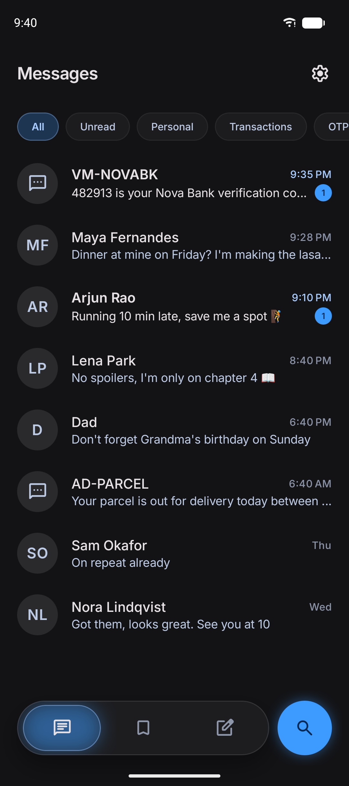
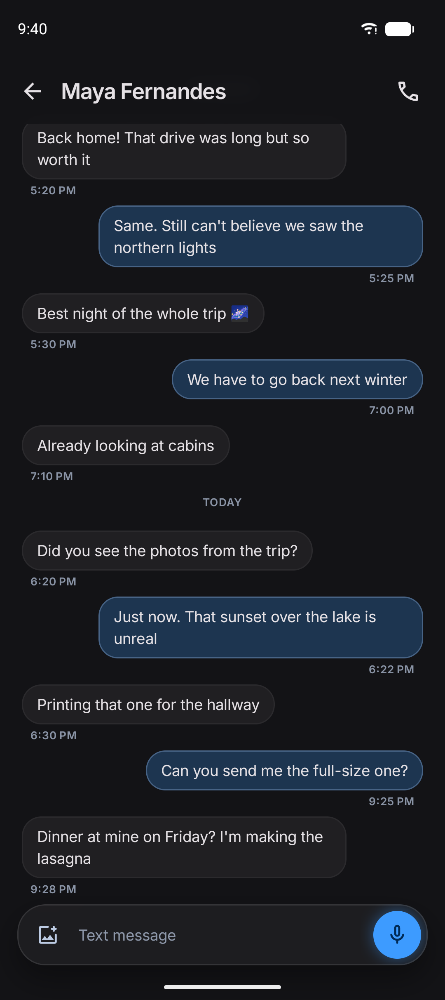
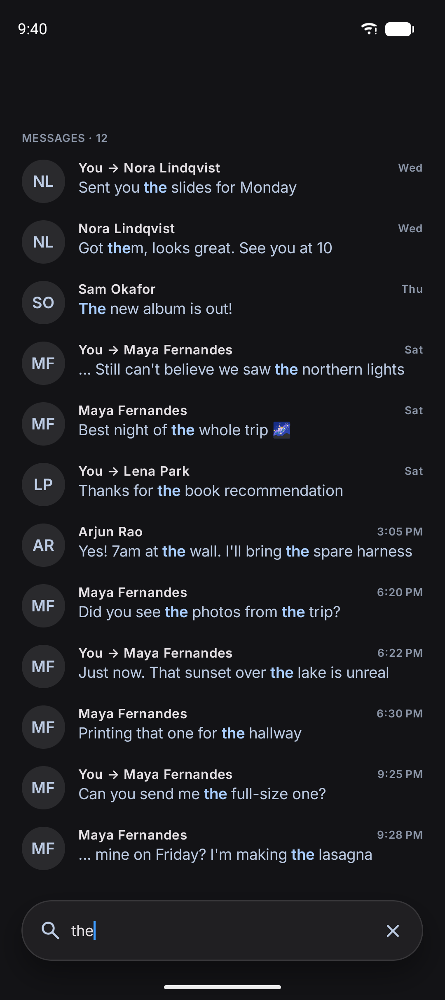
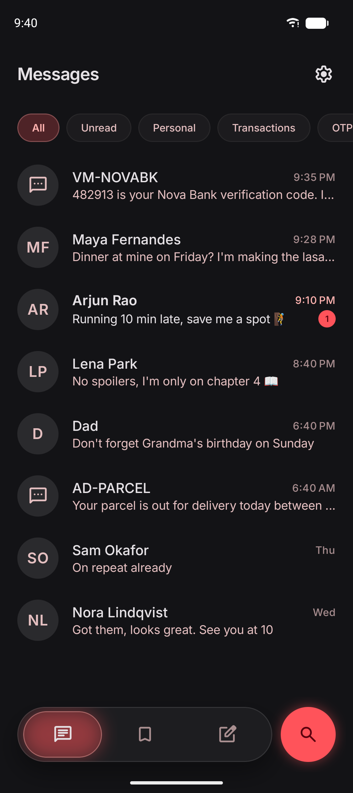

# Messages

**Open-source alternatives to the apps you use every day, except ours feel way too good.**

Messages is a free, open-source SMS and MMS app for Android. It replaces your phone's default messaging
app, and it has no internet permission, so your messages never leave the phone. It's part of
[Redfox OSS](https://github.com/Redfox-OSS) and built on the [Obsidian](https://github.com/Redfox-OSS/obsidian)
design system: always dark, one vivid accent, soft glows, frosted glass and springy motion.

<table>
  <tr>
    <td></td>
    <td></td>
    <td></td>
    <td></td>
  </tr>
</table>

<sub>Screenshots use made-up people and messages.</sub>

## Features

- **Your existing texts.** Conversations load straight from Android's message store, so nothing is lost
  when you switch apps in either direction.
- **Delivery status.** Messages show Sending, Sent, Delivered or "Not sent · Tap to retry".
- **Search.** A full-text index on the device finds words by how they start ("pay" finds "payment") and
  numbers anywhere in a message ("4521" finds XX4521).
- **MMS photos, group texts and voice notes.** Photos are shrunk to fit your carrier's size limit; group
  replies go to everyone; voice notes record from the mic button and play inline.
- **One-time codes.** When a code arrives, a live notification shows it for a few seconds with
  tap-to-copy, and a **Copy** button sits under the message. Codes are copied as sensitive, so Android
  hides them from clipboard previews and history.
- **Starred and scheduled.** Long-press a message to star it; long-press Send to schedule one for later,
  even across reboots. Both live in the **Saved** tab.
- **Inbox your way.** Pin and archive conversations, pick what swiping left and right does (Archive,
  Delete, Read/unread, Pin, Call or nothing), or long-press to select several and mark them read or
  unread, archive or delete them at once.
- **Reply from the notification**, or mark as read without opening the app.
- **Dual SIM.** A SIM badge in the composer, and a counter for how many SMS parts a long message takes.
- **Open in app.** Links to well-known services (Play Store, YouTube, Maps, Amazon and more) get an
  "Open in …" button.
- **Your accent.** Pick any Obsidian accent colour in Settings.

## Privacy

Messages has **no internet permission**. It can't send your messages, contacts or anything else off your
phone, because Android won't let it go online. The manifest goes further and removes the permission, so a
library can't quietly add it back. MMS still works: Android's own MMS service handles the network side.

No analytics, no ads, no crash reporting, no accounts.

## Install

Messages needs **Android 13 or newer**. On first launch it asks to become the default SMS app.

- **F-Droid:** submitted, not listed yet. This README will link to it once it's in.
- **GitHub:** download the APK from the [Releases page](https://github.com/Redfox-OSS/messages/releases).

Both are the same APK with the same signature (F-Droid verifies that our build matches its own), so you
can switch between them and update without reinstalling. The signing certificate's SHA-256 is:

```
8f:cd:2c:a3:fc:50:d0:02:9e:cf:50:3b:5d:e2:73:a5:5b:00:ea:80:98:47:6b:13:6e:99:8e:59:b6:50:61:93
```

## Build

You need JDK 17 or newer (21 for releases) and the Android SDK with compile SDK 36.1.

```bash
git clone https://github.com/Redfox-OSS/messages.git
cd messages
./gradlew installDebug
```

The debug build installs next to the release one (its package name ends in `.debug`). Obsidian
downloads from the Redfox OSS Maven repository on the first build. To build it from source instead,
as F-Droid does, clone with `--recurse-submodules` and add `-Pobsidian.fromSource=true`.

`./gradlew assembleRelease` signs with the key in a git-ignored `keystore.properties` when there is one,
and leaves the APK unsigned otherwise. Published releases come from `tools/release.sh`; see
[fdroid/README.md](fdroid/README.md) for how releases and F-Droid work.

### Project layout

| Path | What |
|---|---|
| `app/` | The app shell: navigation, the nav bar, settings wiring, receivers |
| `feature/*` | One module per screen: onboarding, conversations, thread, search, starred, scheduled, settings |
| `core/*` | Shared layers: model, domain (use cases), data, database (Room), datastore, telephony, MMS (vendored AOSP PDU code), contacts, UI |
| `build-logic/` | Gradle convention plugins, including the check that keeps feature code on Obsidian's design rules |
| `external/obsidian` | The Obsidian design system, as a submodule for from-source builds |
| `fastlane/` | Store listing and screenshots |

## Known limitations

- **No RCS.** Android doesn't let third-party apps send or receive RCS, so Messages is SMS and MMS only.
  If RCS is on for your number, people's messages may go to Google Messages instead. Turn RCS off to get
  them as SMS and MMS.
- **Business chatbot cards** that arrive as MMS are shown read-only. Their reply buttons need RCS, and
  their images aren't downloaded because the app has no internet access.
- **MMS hasn't been tested end to end on every carrier.** If MMS fails for you, please open an issue
  with your carrier and phone.
- English only for now.
- Mostly tested on a Samsung Galaxy S23. Reports from other phones are welcome.

## Contributing

Issues and pull requests are welcome. Please read the org-wide guides first:

- [Contributing](https://github.com/Redfox-OSS/.github/blob/main/CONTRIBUTING.md)
- [Security policy](https://github.com/Redfox-OSS/.github/blob/main/SECURITY.md) (please report
  vulnerabilities privately, not in issues)
- [Code of Conduct](https://github.com/Redfox-OSS/.github/blob/main/CODE_OF_CONDUCT.md)

## License

Messages is licensed under the [Apache License 2.0](LICENSE). It includes AOSP's MMS PDU code, also
Apache 2.0; see [core/mms/NOTICE](core/mms/NOTICE).
